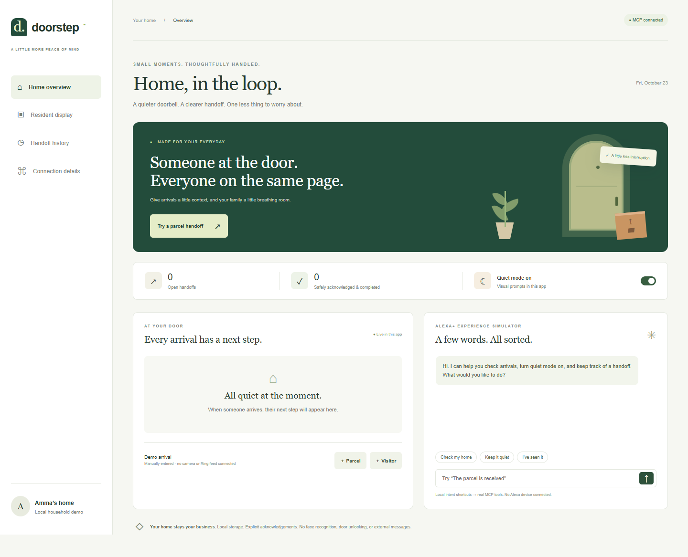

# Doorstep

A quieter arrival, a clearer handoff.



Doorstep helps a household keep track of parcels and visitors without relying on a sound notification. An arrival remains visible until the resident acknowledges it, and completion requires a separate confirmation. A self-hosted MCP server exposes the same workflow to compatible assistants. The included browser acts as a real MCP client and a deliberately limited Alexa+ experience simulator.

## Run locally

Install Node.js 24 LTS and npm. Keep both folders in this repository side by side.

```sh
cd doorstep
npm ci
npm start
```

Open http://127.0.0.1:4317. The default setup needs no accounts, credentials, hardware or paid services. If you download only the `doorstep` subfolder, the sibling `doorstep-flow` library will be missing: clone or download this whole repository.

```sh
cd doorstep
npm test
cd ../doorstep-flow
npm test
```

To include the real socket integration test, run this in PowerShell from `doorstep`:

```powershell
$env:RUN_NETWORK_TESTS='1'
npm test
```

That test requires permission to make local loopback connections. It is explicitly skipped by default; the protocol test still exercises the official MCP client and server through actual HTTP Request/Response objects without opening a socket.

## What is included

| Folder | Purpose |
| --- | --- |
| `doorstep` | Household interface, MCP server, SQLite persistence, optional Bedrock summary, integration tests |
| `doorstep-flow` | Separately reusable MIT state machine with transition and redaction tests |
| `docs` | Submission draft, track evidence, demo script, project walkthrough and release checklist |

## Try it

1. Click **Try a parcel handoff**. A manually entered arrival appears.
2. Open **Resident display**. A large visual prompt stays visible.
3. Select **I've seen it**. Saved handoff instructions appear.
4. Select **It's received**. The resident confirms completion.
5. Check **Handoff history**, then restart the server. State persists.
6. Open **Connection details** to see the negotiated MCP version and real tool requests.

An arrival without acknowledgement becomes `needs_attention` after 120 seconds. This surfaces inside the app only. Doorstep does not send a message to a caregiver or visitor.

## Supported integration

Endpoint: `http://127.0.0.1:4317/mcp`. MCP version: `2025-11-25`. Transport: Streamable HTTP, stateless JSON response mode. Connect a compatible MCP client using its HTTP-server configuration. The server registers six tools through the official `@modelcontextprotocol/sdk`: `home_status`, `record_arrival`, `acknowledge_arrival`, `complete_handoff`, `cancel_handoff`, `set_quiet_mode`.

The browser's chat uses published intent shortcuts. It is not an LLM or a connection to Amazon's gated Alexa+ tooling. An external compatible model client can discover and call the same tools. There is no Alexa certification or native Alexa device integration claimed.

## Optional Amazon Bedrock

The core product works without generative AI. For an optional plain-language status summary, authenticate with your own AWS profile and set `AWS_REGION` and `BEDROCK_MODEL_ID`. Then press **Request optional Bedrock summary**. See `docs/AWS-SETUP.md`. The code imports and calls `BedrockRuntimeClient` and `ConverseCommand`; a live AWS invocation has not yet been verified. Do not claim AWS mini-challenge completion until it has.

## Privacy and limitations

Local SQLite storage includes household preferences, manually entered notes and a transition history. No footage, biometrics or face recognition is collected. Only aggregate `kind` and `status` data and the quiet-mode setting are sent when you explicitly request a Bedrock summary; notes, names and instructions are excluded. Browser chat text is not stored by the server. Local data is not encrypted at rest; use synthetic data for public demos.

The server binds to `127.0.0.1` and rejects unexpected Host/Origin values. This is a single-household local prototype without user authentication. Do not publish this listener or use it for real access control. There is no external messaging, Ring API connection, physical doorbell control, door unlocking or emergency monitoring. The resident display is a browser preview, not a validated Fire TV app.

No end-user research or accessibility certification has been performed. Large text, keyboard navigation, focus indicators, responsive layouts and reduced-motion support are implemented and should be validated with intended users.

## Hackathon status

Prepared for Build, Ship, Shape: Amazon Developer Hackathon. Primary target: Alexa+ self-hosted MCP. Additional Open Source contribution: [doorstep-flow](https://github.com/adithya4001/doorstep-flow). The project uses AI-assisted development; its core workflow is deterministic and works without a generative model.

Seven automated tests passed, including the real HTTP socket integration. The final browser workflow passed against the local Express listener without request interception. See `docs/VERIFICATION.md` for evidence and `docs/RELEASE-CHECKLIST.md` for submission status.
